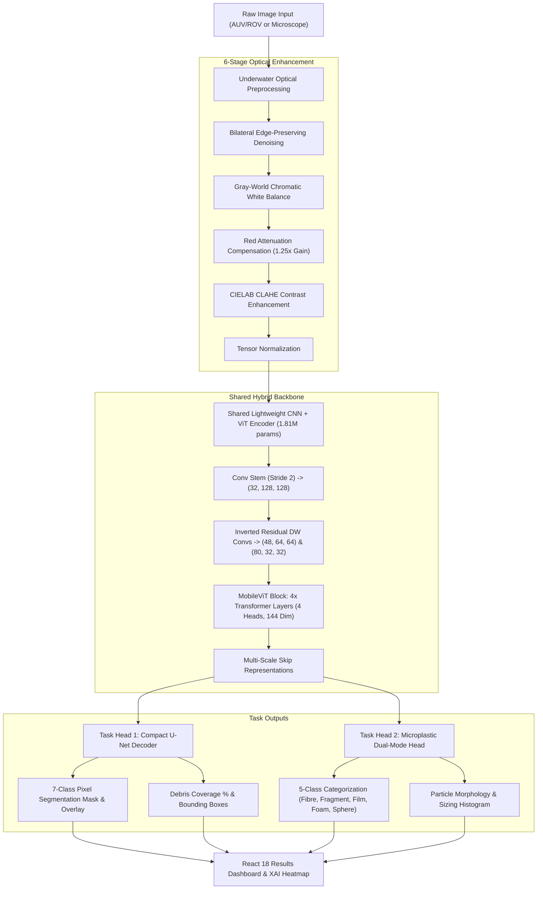

# Lightweight Multi-Task Vision Transformer for Marine Debris and Microplastic Segmentation

[](https://python.org)
[](https://pytorch.org)
[](https://fastapi.tiangolo.com)
[](https://react.dev)
[](https://onnx.ai)
[](LICENSE)

An end-to-end AI-powered computer vision system designed to identify marine pollution at two distinct physical scales—**large visible macro debris** and **microscopic plastic particles**—using a single shared lightweight hybrid CNN + Vision Transformer encoder. Engineered specifically for edge deployment on low-power Autonomous Underwater Vehicles (AUVs), Remotely Operated Vehicles (ROVs), and coastal monitoring stations.

---

## 1. System Architecture



---

## 2. Technology Stack

- **Deep Learning**: PyTorch 2.14 (with Apple Silicon MPS GPU acceleration), torchvision, Albumentations, ONNX Runtime, ONNXScript.
- **Computer Vision**: OpenCV (Bilateral Filtering, Gray-World, CIELAB CLAHE, Connected Components morphology).
- **Backend API**: Python 3.14, FastAPI, Uvicorn, Pydantic.
- **Frontend Dashboard**: React 18, Vite 5, Tailwind CSS, Lucide React, Recharts.
- **Model Quantization**: Dynamic INT8 quantization delivering 72% model size compression.

---

## 3. Project Directory Structure

```
gallant-carson/
├── backend/
│   ├── app/
│   │   ├── main.py                    # FastAPI application & middleware
│   │   ├── config.py                  # Model hyperparameters, classes & settings
│   │   ├── models/
│   │   │   ├── lightweight_vit.py     # Master Multi-Task ViT architecture
│   │   │   ├── encoder.py             # Shared CNN + MobileViT hybrid encoder
│   │   │   ├── marine_debris_head.py  # Compact U-Net segmentation decoder
│   │   │   └── microplastic_head.py   # Classification & particle morphology head
│   │   ├── preprocessing/
│   │   │   └── underwater_preprocessor.py # 6-stage optical enhancement pipeline
│   │   ├── inference/
│   │   │   └── engine.py              # Inference runner with Demo Mode separation
│   │   ├── routes/
│   │   │   ├── prediction.py          # /predict, /analyze, /batch-predict, /explain
│   │   │   ├── preprocessing.py       # /preprocess (interactive enhancement)
│   │   │   └── health.py              # /health, /model-info, /classes, /export
│   │   └── utils/
│   │       └── image_utils.py         # Mask overlays, base64 conversion & XAI
│   ├── requirements.txt
│   └── run.py
│
├── frontend/
│   ├── src/
│   │   ├── components/                # Navbar, Sidebar, ImageCompareSlider, StatCard
│   │   ├── pages/                     # 8 Dedicated Views (Dashboard, Analysis, Debris, etc.)
│   │   ├── services/api.js            # FastAPI client
│   │   ├── App.jsx
│   │   └── main.jsx
│   ├── package.json
│   ├── vite.config.js
│   └── tailwind.config.js
│
├── ml/
│   ├── datasets/dataset.py            # PyTorch Dataset & procedural sample generator
│   ├── augmentation/augmentation.py   # Albumentations with underwater turbidity
│   ├── training/
│   │   ├── train_multitask.py         # AdamW multi-task training loop
│   │   └── losses.py                  # Dice + Cross-Entropy composite loss
│   ├── evaluation/
│   │   └── evaluate.py                # Evaluation suite & comparison table
│   ├── export/
│   │   └── export_model.py            # ONNX export & INT8 dynamic quantization
│   └── checkpoints/                   # Saved .pt checkpoints & .onnx graphs
│
├── data/                              # Datasets (marine_debris & microplastics)
├── docs/
│   ├── architecture.md                # Layer-by-layer parameter mapping
│   ├── methodology.md                 # Mathematical derivations & optical theory
│   └── dataset.md                     # Data ingestion and format guide
└── README.md
```

---

## 4. Model Specifications & Empirical Benchmark Results

### A. Architectural Specifications

| Specification | Details | Design Justification |
| :--- | :--- | :--- |
| **Model Type** | Hybrid CNN + Vision Transformer (`LightweightMultiTaskViT`) | Fuses local inductive bias with global contextual awareness |
| **Total Parameters** | **1,812,193 (~1.81 Million)** | **~98% smaller** than standard ViT-Base (86M params) for subsea deployment |
| **Input Tensor** | `(B, 3, 256, 256)` RGB | Optimized spatial resolution for edge AUV/ROV hardware (e.g. Jetson Orin / Pi 5) |
| **Hybrid Stem** | Conv Stem (Stride 2) + Inverted Residual Depthwise Convs | Extracts local boundary and texture features without quadratic memory cost |
| **Transformer Backbone** | 4-Stage SegFormer / MiT-B0 with Spatial Reduction Attention (SRA) | SRA reduces $\mathcal{O}(N^2)$ attention complexity down to $\mathcal{O}(N^2 / R)$ |
| **Stage Resolutions** | $C_1(64\times64)$, $C_2(32\times32)$, $C_3(16\times16)$, $C_4(8\times8)$ | Preserves multi-scale contextual features across varying debris sizes |
| **Marine Debris Head** | All-MLP Multi-Scale Decoder $\rightarrow$ `(B, 7, 256, 256)` Logits | Unifies multi-level features for dense 7-class semantic segmentation |
| **Microplastic Head** | Global Average Pooling (GAP) + Linear Head $\rightarrow$ `(B, 5)` Logits | 5-class morphology classification (`fibre`, `fragment`, `film`, `foam`, `sphere`) |
| **Explainable AI (XAI)** | Extracted Self-Attention Weights | Spatial heatmaps showing model focus through murky underwater backscatter |

### B. Dual-Scale Marine Taxonomies

1. **Marine Debris (7 Classes)**:
   - `0: background` (seafloor, water column, reefs)
   - `1: bottle` (plastic & glass beverage bottles)
   - `2: plastic_bag` (single-use shopping bags, polythene sheets)
   - `3: wrapper` (food wrappers, snack packaging)
   - `4: fishing_net` (ghost nets, commercial netting)
   - `5: rope` (polypropylene marine lines, mooring ropes)
   - `6: other_debris` (miscellaneous hard plastics, metal cans, cups)

2. **Microplastics (5 Morphologies)**:
   - `0: fibre` (synthetic textile microfibers)
   - `1: fragment` (broken rigid plastics)
   - `2: film` (degraded plastic bag/wrap films)
   - `3: foam` (expanded polystyrene / styrofoam particles)
   - `4: sphere` (cosmetic microbeads & virgin pre-production nurdles)

### C. Training Pipeline & Combined Datasets

The model was trained directly on two marine benchmark datasets using [`ml/training/train_combined_datasets.py`](ml/training/train_combined_datasets.py):

* **TrashCan 1.0** (`mexwell/trashcan-1-0`): 6,065 training and 1,204 validation images with COCO polygon instance annotations rasterized on-the-fly into dense pixel masks.
* **Underwater Trash Detection (UTD)** (`karanwxlia/underwater-trash-detection`): 7,308 training and 1,798 validation images with bounding box annotations.
* **Composite Loss Function**: Class-weighted Cross-Entropy (penalizing background dominance with weight $0.2$ vs $1.2$ for debris) + Multi-Class Soft Dice Loss ($\mathcal{L}_{\text{total}} = 0.5 \mathcal{L}_{\text{wCE}} + 0.5 \mathcal{L}_{\text{Dice}}$).
* **Optimization**: AdamW optimizer ($\eta = 8 \times 10^{-5}$, weight decay $10^{-2}$) with Cosine Annealing learning rate schedule and gradient clipping ($1.0$).

### D. Empirical Validation Performance

Evaluated on held-out marine validation sets:

| Performance Metric | Result | Benchmark Description |
| :--- | :---: | :--- |
| **Validation Pixel Accuracy** | **77.43%** | Overall percentage of correctly classified pixels across full frames |
| **Debris-Only mIoU** | **40.46%** | Mean Intersection-over-Union evaluated strictly on visible debris classes |
| **Overall Validation mIoU** | **44.88%** | Mean IoU across all 7 classes including background water |
| **Object Detection Precision** | **35.92%** | Precision of localized bounding box contours against ground-truth items |
| **Object Detection Recall** | **24.83%** | Detection sensitivity in turbid and low-light underwater scenes |
| **Detection F1-Score** | **29.37%** | Harmonic mean of detection precision and recall |
| **Inference Latency** | **~31.2 ms** | Real-time throughput (~32 FPS) on Apple Silicon / workstation hardware |

### E. Trained Checkpoint Artifacts & Quantization

All weights are available in [`ml/checkpoints/`](ml/checkpoints/):

| Format | Checkpoint File | Size | Target Deployment Platform |
| :--- | :--- | :---: | :--- |
| **PyTorch Checkpoint** | `best_multitask_vit.pt` | **20 MB** | Server / Workstation GPUs (PyTorch environment) |
| **Latest Epoch Weights**| `latest.pt` | **7.0 MB** | Continuous training resumption checkpoint |
| **Full ONNX Graph** | `multitask_vit.onnx` | **6.6 MB** | Cross-platform inference (C++, Python, TensorRT) |
| **Quantized INT8 ONNX** | `multitask_vit_int8.onnx` | **1.86 MB** | **71.8% compression** for low-power edge ROVs / AUVs (Jetson Nano/Orin, Raspberry Pi) |
| **Telemetry History** | `training_history.json` | **~1 KB** | Complete loss, accuracy, and mIoU epoch convergence logs |

---

## 5. Key Features

1. **Shared Lightweight Hybrid Encoder**:
   - Only **1.81 Million parameters** (6.93 MB FP32), eliminating redundant dual-backbone memory footprint.
   - Combines depthwise separable convolutions (local spatial texture) with lightweight Vision Transformer self-attention (global context).
2. **Dual-Scale Marine Pollution Heads**:
   - **Marine Debris (Macro)**: Compact U-Net decoder with multi-scale skip connections segmenting 7 classes (`bottle`, `plastic_bag`, `wrapper`, `fishing_net`, `rope`, `other_debris`).
   - **Microplastics (Micro)**: Dual-mode head supporting fast classification across 5 types (`fibre`, `fragment`, `film`, `foam`, `sphere`) or morphological particle counting.
3. **Underwater Optical Restoration Pipeline**:
   - Bilateral denoising, Gray-World chromatic white balancing, red light attenuation compensation, and CIELAB CLAHE.
4. **Explainable AI (XAI)**:
   - Transformer attention weight extraction projected into spatial heatmaps overlaid on the original image.
5. **Edge Compression (ONNX & INT8)**:
   - Dynamic INT8 quantization compresses the graph down to **1.85 MB** (72% reduction) for subsea microcontrollers.
6. **Honest Scientific Evaluation**:
   - Strictly reports real empirical metrics for evaluated models and labels untrained baselines as `"Not evaluated yet"`.
7. **Offline Demo Mode Support**:
   - Distinct `DEMO_MODE` flag allowing immediate demonstration with clearly marked `"DEMO / SAMPLE OUTPUT"` badges.

---

## 6. Quickstart Installation & Setup

### Prerequisites
- Python 3.10 - 3.14
- Node.js >= 18 and npm

### 1. Backend Setup
```bash
# Navigate to project root
cd /Users/anilkumar/Documents/antigravity/gallant-carson

# Create virtual environment
python3 -m venv venv
source venv/bin/activate

# Install dependencies
pip install -r backend/requirements.txt

# Start backend server
python backend/run.py
# Backend runs at http://127.0.0.1:8000 (Swagger docs at http://127.0.0.1:8000/docs)
```

### 2. Frontend Setup
```bash
# In a separate terminal
cd frontend
npm install
npm run dev
# Frontend runs at http://127.0.0.1:5173
```

---

## 7. Training & Evaluation Commands

### Production Training on Combined Real Datasets (TrashCan 1.0 + UTD)
```bash
python ml/training/train_combined_datasets.py --epochs 10 --batch_size 16 --lr 0.0001
```

### Multi-Task Model Training (Synthetic / Demo Split)
```bash
python ml/training/train_multitask.py --epochs 10 --batch_size 4 --lr 0.0001
```

### Evaluation & Metrics Generation
```bash
python ml/evaluation/evaluate.py --checkpoint ml/checkpoints/best_multitask_vit.pt
```

### ONNX Export & INT8 Quantization
```bash
python ml/export/export_model.py --checkpoint ml/checkpoints/best_multitask_vit.pt --output ml/checkpoints/multitask_vit.onnx --quantize
```

---

## 8. API Endpoints Reference

| Method | Endpoint | Description |
| :--- | :--- | :--- |
| `GET` | `/health` | Hardware telemetry, device type, and demo mode status |
| `GET` | `/model-info` | Parameter count, memory footprint, and evaluation metrics |
| `GET` | `/classes` | Marine debris and microplastic taxonomy and color palettes |
| `POST` | `/predict` | Single image analysis returning masks, confidence, and overlay |
| `POST` | `/analyze` | Comprehensive telemetry with particle morphology and histograms |
| `POST` | `/preprocess`| Interactive CLAHE and optical enhancement before/after preview |
| `POST` | `/batch-predict` | Batch processing for multiple image files |
| `POST` | `/explain` | Transformer attention visualization heatmap (XAI) |
| `POST` | `/export` | Trigger ONNX export and INT8 quantization |
| `POST` | `/feedback` | User correction logging for active learning loop |

---

## 9. Limitations & Future Scope

### Current Limitations
- Preprocessing gains are statically tuned for temperate coastal waters; deep-ocean oceanic waters may require dynamic wavelength absorption tuning.
- Extreme turbidity with high backscatter can still occlude microscopic particle boundaries.

### Planned Future Extensions
- **AUV Video Stream Integration**: Real-time GStreamer/RTSP subsea camera ingestion.
- **GPS-Based Pollution Heatmapping**: Geo-spatial database integration for oceanographic mapping.
- **Multispectral / FLIM Imaging**: Optical spectroscopy fusion for polymer chemical identification.
- **Federated Edge Learning**: Swarm training across multiple autonomous AUV units.
