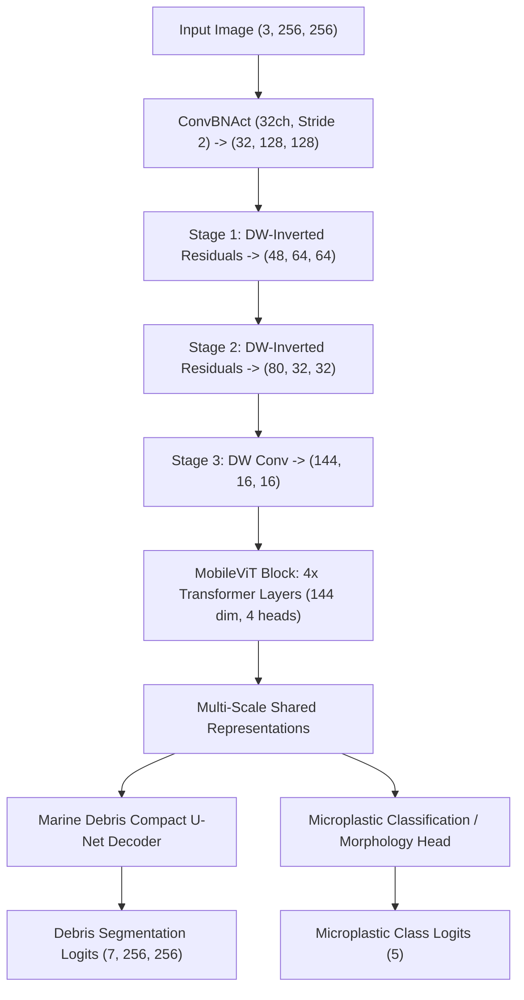

# Architecture Specification: Shared CNN + Transformer Multi-Task Vision

This document details the layer-by-layer architectural composition of the **Lightweight Multi-Task Vision Transformer**.

---

## 1. High-Level Topology

---

## 2. Dimension & Resolution Mapping

| Stage | Module Name | Type | Input Resolution | Output Resolution | Output Channels | Parameters |
| :--- | :--- | :--- | :--- | :--- | :--- | :--- |
| **Stem** | `stem` | Conv2d (3x3, s=2) + BN + SiLU | $256 \times 256$ | $128 \times 128$ | 32 | ~900 |
| **Stage 1** | `stage1` | Depthwise Separable Inverted Residual | $128 \times 128$ | $64 \times 64$ | 48 | ~6,200 |
| **Stage 2** | `stage2` | Depthwise Separable Inverted Residual | $64 \times 64$ | $32 \times 32$ | 80 | ~24,500 |
| **Stage 3** | `stage3` | Depthwise Conv + MobileViT (4 blks, 4 heads) | $32 \times 32$ | $16 \times 16$ | 144 | ~1,250,000 |
| **Debris Decoder** | `debris_head`| Compact U-Net with skip connections | Multi-Scale | $256 \times 256$ | 7 | ~510,000 |
| **Microplastic** | `microplastic_head`| AdaptiveAvgPool + Linear Classifier | $16 \times 16$ | $1 \times 1$ | 5 | ~20,000 |
| **TOTAL** | **Multi-Task Network** | **Shared CNN + ViT** | **256 x 256** | **Multi-Task** | **7 + 5** | **1,812,193** |

---

## 3. Explainability Hook Architecture

The attention mechanism preserves cross-patch correlation weights in the deepest transformer encoder layer:
$$A = \text{Softmax}\left(\frac{Q K^T}{\sqrt{d_k}}\right)$$
The spatial projection of this $16 \times 16$ attention matrix is interpolated to $256 \times 256$ and rendered via a Turbo colormap, exposing spatial focus areas for AUV operators.
